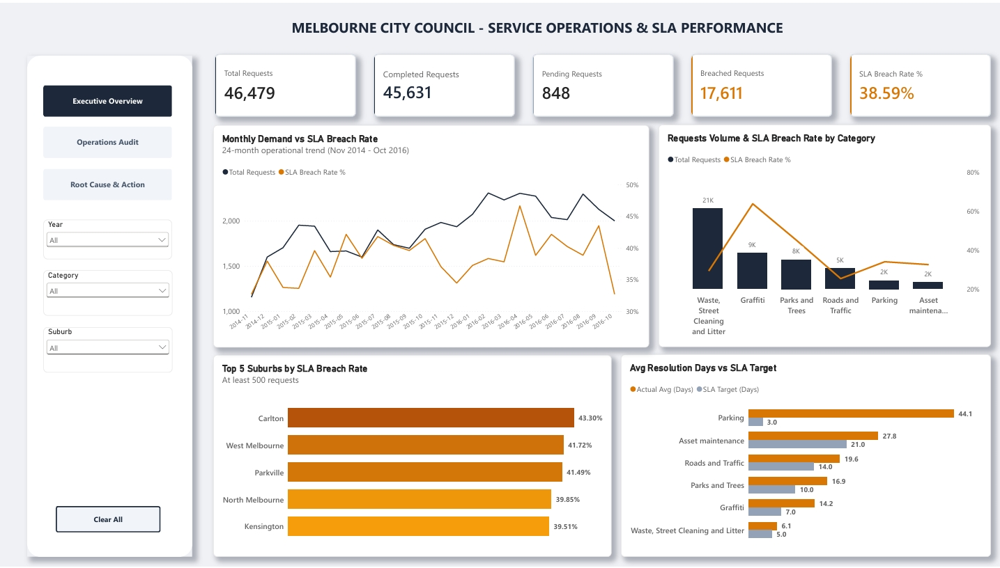
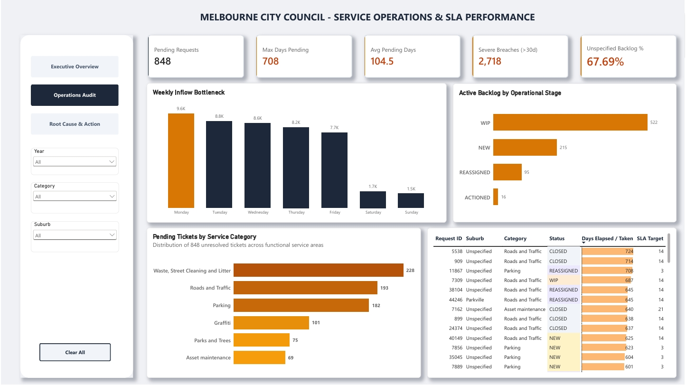
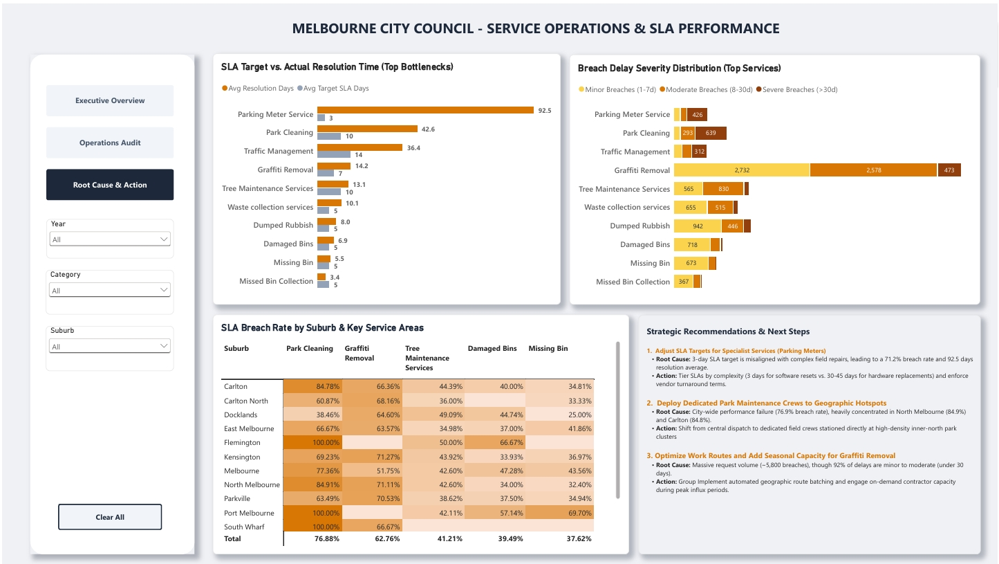

# 🏛️ City of Melbourne - Council Service Operations & SLA Performance Analytics

[](#)
[](#)
[](#)

An end-to-end operational audit and decision-support BI project analyzing citizen service requests, resolution turnaround times, and SLA compliance trends for the City of Melbourne.

📄 **[View & Download Multi-Page Executive Report (PDF)](./melbourne_council_service_performance.pdf)**

---

## 📌 Project Overview & Problem Statement

Local city councils face the challenge of managing high volumes of citizen service requests while maintaining strict Service Level Agreement (SLA) standards. When SLAs are repeatedly breached, operational transparency drops, resident satisfaction declines, and maintenance costs increase.

* **Business Problem:** The City of Melbourne experienced an overall **38.59% SLA breach rate** (17,611 out of 45,631 completed tickets breached), alongside an active backlog of **848 unresolved requests** pending for up to 708 days.
* **Objective:** Build an end-to-end Power BI reporting system to:
  1. Audit request volumes and council-wide SLA compliance trends.
  2. Pinpoint functional and geographic bottlenecks causing severe ticket delays.
  3. Conduct root-cause analysis to deliver actionable, data-backed operational improvements.

---

## 🧱 Data Architecture & Modeling

The reporting architecture uses a normalized **Star Schema** to ensure fast query response, dynamic cross-filtering, and granular slicing across dimensions.

* **Fact Table:** `fact_service_requests` (46,479 rows)
  * Metrics & Time: `days_to_complete` (or days elapsed), `sla_target_days`, `request_date`.
  * Status Fields: `request_status` (`CLOSED`, `WIP`, `NEW`, `REASSIGNED`), `sla_status` (`Met`, `Breached`, `Pending`).
* **Dimension Tables:**
  * `dim_date`: Continuous calendar table covering Nov 2014 – Oct 2016.
  * `dim_category`: 6 service categories mapped to 27 detailed service types (`service_desc`).
  * `dim_geography`: Suburb boundaries across the City of Melbourne.

### Data Quality & Logic Rules
* **SLA Status Segmentation:**
  * Closed Requests (`request_status = 'CLOSED'`): Evaluated definitively as either 'Met' or 'Breached' based on actual days taken versus the SLA target.
  * Active Requests (`request_status` in WIP, NEW, REASSIGNED, ACTIONED): Standardized under 'Pending' to track active operational backlog without skewing historical completion metrics.
* **Metric Calculation Rule:** `Avg Resolution Days` strictly excludes `sla_status = 'Pending'` to ensure only finalized tickets are measured.
* **Geographic Data Handling:** Suburb records marked as "Unspecified" (which account for 67.7% of pending backlog) were isolated to avoid misleading suburb-level performance comparisons.

---

## 📐 Core DAX Formulations

Code snippet

<details>
<summary><b>👉 Click to expand / view Core DAX Formulations</b></summary>

```dax
-- 1. Total & Closed Requests
Total Requests = COUNTROWS(fact_service_requests)

Completed Requests =
CALCULATE(
    COUNTROWS(fact_service_requests),
    fact_service_requests[sla_status] <> "Pending"
)

-- 2. Breach Volume & Rate
Breached Requests =
CALCULATE(
    COUNTROWS(fact_service_requests),
    fact_service_requests[sla_status] = "Breached"
)

SLA Breach Rate % =
DIVIDE([Breached Requests], [Completed Requests], 0)

-- 3. Average Resolution Days (Excluding In-Flight / Pending)
Avg Resolution Days =
CALCULATE(
    AVERAGE(fact_service_requests[days_to_complete]),
    fact_service_requests[sla_status] <> "Pending"
)

-- 4. Breach Severity Tiers
Minor Breaches (1-7d) =
CALCULATE(
    COUNTROWS(fact_service_requests),
    fact_service_requests[sla_status] = "Breached",
    (fact_service_requests[days_to_complete] - fact_service_requests[sla_target_days]) >= 1,
    (fact_service_requests[days_to_complete] - fact_service_requests[sla_target_days]) <= 7
)

Moderate Breaches (8-30d) =
CALCULATE(
    COUNTROWS(fact_service_requests),
    fact_service_requests[sla_status] = "Breached",
    (fact_service_requests[days_to_complete] - fact_service_requests[sla_target_days]) >= 8,
    (fact_service_requests[days_to_complete] - fact_service_requests[sla_target_days]) <= 30
)

Severe Breaches (>30d) =
CALCULATE(
    COUNTROWS(fact_service_requests),
    fact_service_requests[sla_status] = "Breached",
    (fact_service_requests[days_to_complete] - fact_service_requests[sla_target_days]) > 30
)
```
</details>

---

## 📊 Dashboard Walkthrough & Key Insights

### Page 1: Executive Overview (Council-Wide SLA & Demand Performance)


* **Key Metrics:** 46,479 total requests, 38.59% overall SLA breach rate (17,611 breached cases), and 848 pending backlog items.
* **24-Month Demand Trend:** Breach rates peaked during mid-2015 and Q2 2016, showing regular performance dips when request volume spikes after holidays.
* **High Volume vs. High Risk Categories:**
  * *Waste, Street Cleaning & Litter* handles the highest volume (~21K requests) but maintains strong SLA control (6.1 actual days vs. 5-day target).
  * Conversely, *Parking* and *Parks & Trees* show breach rates above 40%, driven by long delays rather than ticket volume.
* **Target vs. Actual Gap:** *Parking* shows the largest operational gap, taking an average of 44.1 days to resolve against a strict 3-day target.
* **Geographic Hotspots:** Across high-volume suburbs, Carlton (43.3%), West Melbourne (41.7%), and Parkville (41.5%) experience the highest breach rates.

---

### Page 2: Operations Audit (Pending Backlog & Workflow Bottlenecks)


* **Backlog Aging:** The active backlog averages 104.5 pending days, with the oldest unresolved requests lingering up to 708 days.
* **Weekly Inflow Surge:** Ticket creation concentrates heavily on Mondays (~9.6K requests), creating dispatch pressure for the rest of the work week.
* **Execution Bottleneck:** Over 61% of unresolved requests (522 of 848) are trapped in the 'WIP' stage, indicating that delays occur primarily during field execution rather than administrative triage (NEW: 215, REASSIGNED: 95).
* **Backlog Volume by Category:** *Waste, Street Cleaning & Litter* holds the largest backlog volume (228 tickets), followed closely by *Roads & Traffic* (193) and *Parking* (182).
* **Data Quality Gap:** 67.69% of pending requests lack suburb attribution (recorded as "Unspecified"), highlighting intake data logging gaps.

---

### Page 3: Root Cause Analysis & Strategic Recommendations


* **Root Cause 1 - Unrealistic SLA Targets (Parking Meter Service):**
  * Resolution averages 92.5 days against a 3-day target (71.2% breach rate), with 426 cases delayed by more than 30 days.
  * The flat 3-day SLA fails to account for complex hardware repairs and external contractor dependency, treating them the same as minor software resets.
* **Root Cause 2 - Systemic Capacity Shortage (Park Cleaning):**
  * Delays are council-wide rather than localized: 76.88% overall breach rate, averaging 42.6 days against a 10-day target.
  * Severe performance breakdowns concentrate heavily in high-density suburbs like North Melbourne (84.91%) and Carlton (84.78%).
* **Root Cause 3 - Volume-Driven Workload (Graffiti Removal):**
  * Represents the single highest volume of breaches (~5,800 cases).
  * 92% of delays fall within the 1-30 day range (2,732 cases within 1-7 days; 2,578 within 8-30 days), proving work is actively moving but field crews are simply overwhelmed by sheer intake volume.

---

## 🎯 Strategic Action Plan

| Strategic Area | Operational Root Cause | Proposed Intervention |
| :--- | :--- | :--- |
| **1. Parking Meter SLA Calibration** | A flat 3-day SLA target is unrealistic for complex hardware failures requiring replacement parts and external vendor support. | • **Tiered SLAs:** Set a 3-day SLA for simple software resets, and 30–45 days for complex hardware replacements.<br>• **Vendor Management:** Re-negotiate response time commitments and service level agreements with hardware contractors. |
| **2. Dedicated Park Maintenance** | Centralized crew dispatch causes delays in park maintenance, pushing breach rates above 80% in key suburbs (such as Carlton and North Melbourne). | • **Local Dedicated Hubs:** Shift from central dispatch to dedicated maintenance teams stationed directly at high-demand park zones (Carlton and North Melbourne).<br>• **Proactive Scheduling:** Move from reactive resident reporting to scheduled weekly maintenance sweeps for major parks. |
| **3. Graffiti Surge Management** | Seasonal request surges overwhelm in-house cleaning crews, creating a temporary processing backlog. | • **Route Optimization:** Group cleaning tickets by geographic clusters to minimize crew travel time across the council area.<br>• **On-Demand Contractor Panels:** Partner with pre-approved local contractors to absorb excess demand during peak periods without letting queues build up. |

---

## 🛠️ Repository Structure

```text
melbourne_council_service_analytics/
│
├── data/                                 # Raw & processed datasets
│   ├── processed/
│   └── raw/
├── images/                               # Dashboard screenshots for documentation
│   ├── page1_executive_overview.jpeg
│   ├── page2_operations_audit.jpeg
│   └── page3_root_cause_and_action.jpeg
├── scripts/                              # Data processing pipeline scripts (Python)
│   ├── explore.py                        # Exploratory data analysis (EDA)
│   ├── etl_pipeline.py                   # Data cleaning & SLA logic standardization
│   └── build_database.py                 # SQLite database construction & star schema load
├── sql/                                  # Data modeling & analytical queries (SQLite)
│   └── analysis_queries.sql              # SLA performance & backlog audit queries
├── melbourne_council_service_performance.pbix  # Main Power BI Model & Dashboard
├── melbourne_council_service_performance.pdf   # Multi-page presentation report
├── .gitignore                            # Git exclusion rules (.venv, .vscode)
└── README.md                             # Project documentation